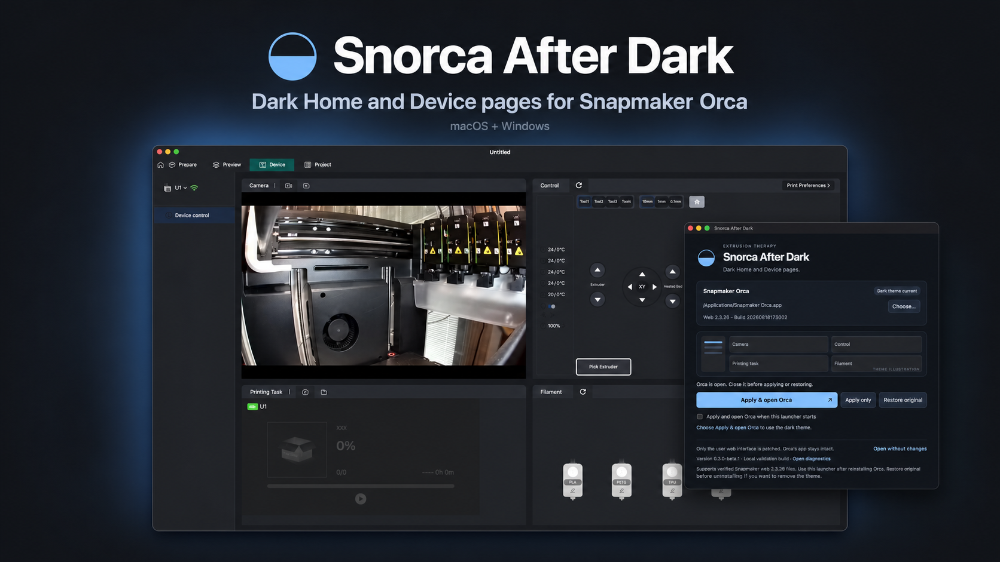

# Snorca After Dark

Dark Home and Device pages for **Snapmaker Orca**, matched to its native gray palette. Apply once, then close Snorca After Dark—the theme stays in place.

## Download

- **[Windows x64 installer](https://github.com/rdcstout/Snorca-After-Dark/releases/latest/download/Snorca-After-Dark-Setup-Windows-x64.exe)**
- **[Linux x64 Flatpak](https://github.com/rdcstout/Snorca-After-Dark/releases/latest/download/Snorca-After-Dark-Linux-x64.flatpak)**
- **[Linux Debian/Ubuntu installer](https://github.com/rdcstout/Snorca-After-Dark/releases/latest/download/Snorca-After-Dark-Linux-x64.deb)**
- **[Legacy Mac Apple silicon release 0.3.4](https://github.com/rdcstout/Snorca-After-Dark/releases/download/v0.3.4/Snorca-After-Dark-macOS-arm64.dmg)** — Orca 2.3.6 and 2.4.0 only.

Version **0.3.5** supports Windows and Linux. The Windows installer is unsigned. [Installation and removal](docs/USAGE.md) · [Linux setup](docs/LINUX.md).

**macOS support ends with Snapmaker Orca 2.4.1.** Earlier supported Orca versions can keep using the legacy Mac release. [Why macOS support is ending](docs/SUPPORT-UPDATE.md).

## Use

1. Close Snapmaker Orca.
2. Open Snorca After Dark and select your Orca installation if needed.
3. Click **Apply theme**, then open Orca normally.

**Restore original** removes the theme. Reapply after updating or reinstalling a compatible Orca version. Keep the restore backups until you no longer need them.

## Compatibility

Windows and Linux support verified resources from Orca **2.3.6**, **2.4.0**, and **2.4.1**. Windows 2.4.1 patching and Ubuntu 2.4.1 apply/restore are confirmed. Ubuntu testing used a user-installed Orca Flatpak. Other Linux distributions and system-wide Orca Flatpak installations are not validated.

For 2.4.1, After Dark patches the installed web resources; older versions use the user web directory. Printer settings and the slicer executable are outside the patch target. Unknown or independently modified web builds are refused.

The app menu includes **Check for Updates** and optional quiet weekly checks. Downloads and installation stay under your control.

## Help and source

[Report a bug](https://github.com/rdcstout/Snorca-After-Dark/issues) · [Security reports](SECURITY.md) · [Build from source](docs/DEVELOPMENT.md) · [MIT license](LICENSE)

Created by [Extrusion Therapy](https://extrusiontherapy.com). This is an independent utility, not affiliated with or endorsed by Snapmaker. The hero is promotional artwork based on an actual app screenshot.

## Support Future Tools

Snorca After Dark is free. You can optionally [support future Extrusion Therapy tools](https://buy.stripe.com/fZu3cw2Mnfr0d7N3ws1kA00). Downloads are never gated behind payment.

## Contribution and security policies

See [CONTRIBUTING.md](CONTRIBUTING.md) for changes and validation, and [SECURITY.md](SECURITY.md) for reporting suspected vulnerabilities.
